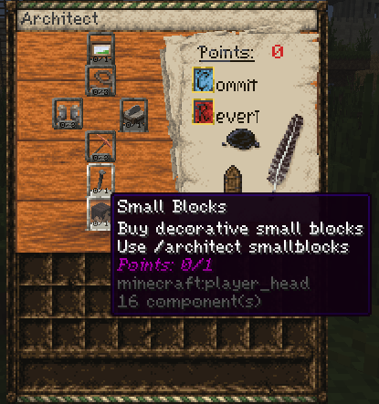
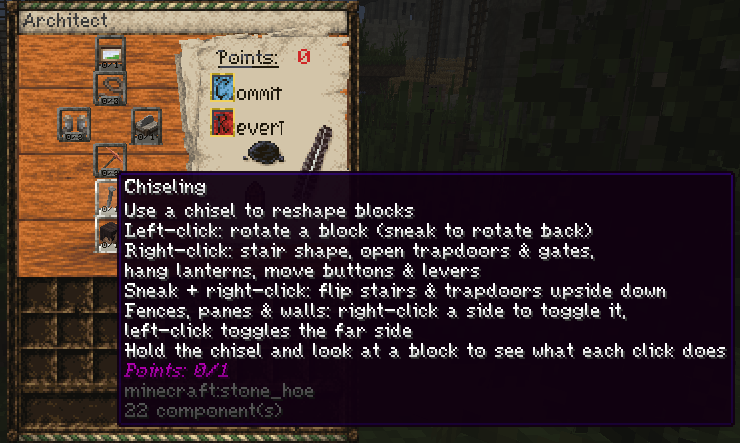
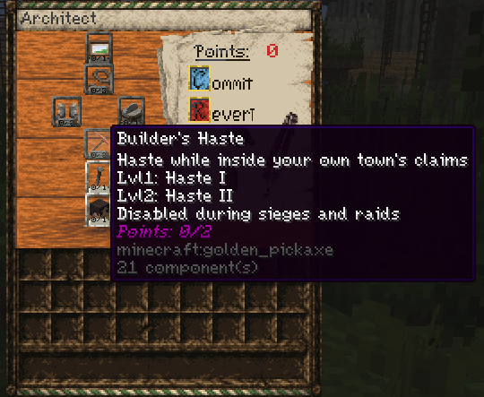
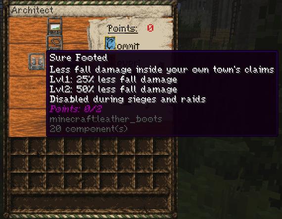
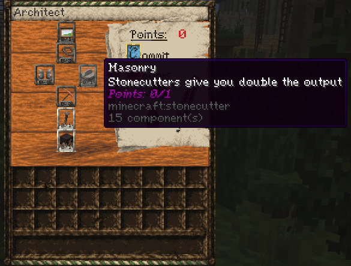
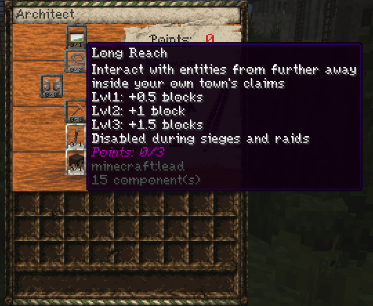
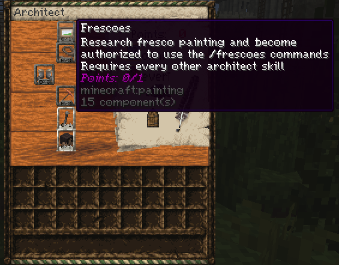

# Architect

Open `/mp` or `/professions`, select Architect, and click **Join**. Click **Inspect** to open the skill tree. Spend points by clicking skills, then click **Commit** to save your choices.

## XP Gain

Earn Architect XP in Survival by doing any of the following:

- Quarry naturally generated blocks such as stone, deepslate, tuff, sandstone, and blackstone. Breaking blocks that players placed or generators formed gives no XP.
- Take a crafted result out of a stonecutter. You earn XP per craft, even before unlocking Masonry.
- Take smelted terracotta or glazed terracotta out of a furnace.

## Skill Tree

Builder's Haste, Sure Footed, and Long Reach work inside your own town's claims. These bonuses are disabled during raids on your town and active sieges involving your town or nation, or while you are in an active siege zone.

### Small Blocks

Unlock this skill to buy decorative miniature blocks with `/architect smallblocks`. Hover over a block to see its price. Click to buy one or shift-click to buy 16.

### Chiseling

Craft a **Chisel** with an iron ingot directly above a stick. Hold it in your main hand and look at a block to see the available controls above your hotbar. You can chisel only where you have permission to build. Each edit uses one durability in Survival.

| Control | What it does |
| --- | --- |
| Left-click | Rotate a supported block or cycle its axis. Sneak to cycle backward. |
| Right-click | Cycle stair shapes, open or close trapdoors and fence gates, switch lanterns between hanging and standing, or move buttons and levers between floor, wall, and ceiling. |
| Sneak + right-click | Flip stairs and trapdoors between their upper and lower positions. |
| Right-click a side of a fence, pane, or wall | Toggle the targeted connection. Left-click to toggle the opposite side. |

### Builder's Haste

Level 1 gives Haste I. Level 2 gives Haste II.

### Sure Footed

Level 1 reduces fall damage by 25%. Level 2 reduces it by 50%.

### Masonry

Get twice the usual output from each stonecutter craft for the same input.

### Long Reach

Interact with entities from farther away. Levels 1, 2, and 3 add 0.5, 1, and 1.5 blocks of reach, respectively.

### Frescoes

Max out the other six Architect skills to unlock the `/frescoes` commands.

1. Buy a brush with `/frescoes buy brush`, a palette with `/frescoes buy palette`, and a blank canvas with `/frescoes buy <width> <height>`. Canvas dimensions are in blocks.
2. Right-click a wall with the canvas. The block you click becomes the bottom-left corner. To paint on an easel, buy one with `/frescoes buy easel`, place it on top of a solid block, then right-click it with the canvas.
3. Hold the brush in your main hand and the palette in your offhand. Sneak and right-click to open the color menu. Left-click a painted spot to pick up its color.
4. Aim at the canvas and hold right-click to paint. Once the brush has a color, you can paint with your offhand free.
