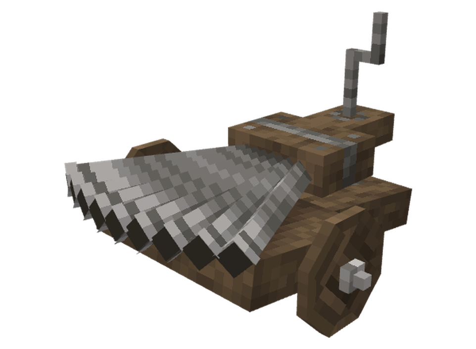

# Ribauldequin

The Ribauldequin fires a rapid volley from its nine barrels. It breaks after 200 volleys.

## Adjusting

With an empty hand, right or left click to raise or lower the barrels. Sneak and click to rotate the Ribauldequin.

## Loading

Right click with three Gunpowder Pouches, then right click with one Canister Shot.

## Firing

Right click the Ribauldequin with a flint and steel to fire. It shoots one bullet from each barrel in quick succession. Wait seven seconds for the smoke to clear before firing again.
